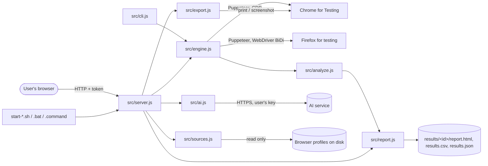

# Architecture

Last updated: 2026-10-22T22:16:52+05:30

How Chrome Firefox Browser Extensions Impact Analyser is put together, how data moves through it, and where its boundaries are. For the reasons behind these choices, see [DECISIONS.md](DECISIONS.md). For terms, see [DOMAIN.md](DOMAIN.md).

## At a glance

A single Node.js process runs on the user's computer. It serves a small web app on `127.0.0.1`, reads browser profiles from disk, drives separate test browsers through Puppeteer, and writes results to the `results` folder. There is no build step, no database and no cloud service. The only optional outside service is the AI provider the user connects.

## Components

| Component | File | Responsibility |
|---|---|---|
| Start files | `start-linux.sh`, `start-macos.command`, `start-windows.bat` | Check Node.js 22.12+, run `npm install` on first start (which downloads Chrome for Testing), start the server and open the app. |
| Server | `src/server.js` | HTTP server on `127.0.0.1` (port 4777, or a free one). Serves the app (`ui/`), the reports, downloads and the JSON API. Holds run state and pushes live progress with server-sent events. |
| Profile reader | `src/sources.js` | Finds Chromium-family "User Data" folders and Firefox `profiles.ini` on Windows, macOS and Linux; lists extensions from `Preferences` / `Secure Preferences` (Chromium) or `extensions.json` (Firefox); reads manifests, names and icons, including inside `.xpi` files with a small built-in zip reader. Read only. |
| Test engine | `src/engine.js` | Copies extensions to a temporary folder, starts one clean browser per setup, installs the extensions, warms them up, loads each website several rounds in random order, and records every page load. Downloads Firefox on first Firefox use. |
| Analysis | `src/analyze.js` | Medians per setup and website, minus the no-extension median; noise limits; verdicts and plain-language summaries. Holds the verdict thresholds. |
| Report | `src/report.js` | Self-contained HTML report with its own page script (sort, filter, search, totals, theme, Markdown download), plus CSV and JSON. When served by the app it also gets the app token, which unlocks re-tests, PDF / PNG / Word downloads and the assistant. |
| Exports | `src/export.js` | PDF and PNG by opening the report in Chrome for Testing; Word (`.docx`) built from the data with the `docx` library. |
| AI assistant | `src/ai.js` | Provider presets, saved connection (`.local/ai.json`), the request loop for Anthropic-style and OpenAI-compatible APIs, and three tools: read results, estimate a combination, propose a test. |
| App pages | `ui/index.html`, `ui/app.js`, `ui/styles.css` | Three-step wizard, run screen, results, past reports. Plain JavaScript modules, no framework. |
| Command line | `src/cli.js` | Same engine without the web app, for scripting. |

## Data flow of one test

1. **Choose.** The app asks the server for profiles (`GET /api/init`) and a profile's extensions (`POST /api/extensions`). The user picks extensions, websites and thoroughness.
2. **Start.** `POST /api/run` (or `/api/rerun` from a report) calls `runBenchmark` in `src/engine.js`.
3. **Prepare.** Each chosen extension is copied into a temporary folder. Chromium copies leave out top-level folders starting with `_` (except `_locales`), which Chrome refuses to load.
4. **Probe.** One browser start with no extensions learns the browser version and warms up DNS for each website.
5. **Warm up.** Each setup (no extensions, each extension alone, all together) gets its own browser profile folder. Extensions are installed and given time to finish first-run work. An extension that fails to load is left out with a warning.
6. **Measure.** For each round, setups run in a new random order. Each setup starts a fresh browser, installs its extensions, waits, then loads every website once with an empty cache and cookies cleared, and records the page load.
7. **Analyse.** `analyze()` turns page loads into per-extension results and verdicts.
8. **Save.** `writeReport()` writes `results/<date-time>/results.json`, `results.csv` and `report.html`. The temporary folder is deleted.
9. **Show.** The app and any open report receive the `done` event and link to the new report.

Progress, phases and warnings stream to every open page through `GET /api/events`.

## What is measured, per page load

| Field | Chrome for Testing | Firefox |
|---|---|---|
| `mainThreadMs` (extra work) | `TaskDuration` from DevTools `Performance.getMetrics` | Sum of gaps over 10 ms seen by a repeating timer on the page |
| `tbt` (page frozen) | Long tasks over 50 ms, counted from the start of the visit | Part of each timer gap over 50 ms |
| `load`, `domContentLoaded`, `fcp`, `lcp` | Navigation Timing and paint entries | Same |
| `pageHeapMB` | `JSHeapUsedSize` | Not available |
| `requests`, `transferKB` | DevTools network events | Requests only |
| `browserCpuMs` | `SystemInfo.getProcessInfo` | Not available |
| Extension memory | Heap of extension service workers and background pages | Not available |

## Boundaries and trust

* **User's browsers:** read only. Profiles are never written; extensions are copied, not run in place.
* **Network listener:** `127.0.0.1` only. Requests must use the host `127.0.0.1:<port>` or `localhost:<port>` (blocks DNS rebinding), and every `/api/` call and every PDF / PNG / Word download needs the random token embedded in the served page.
* **Test browsers:** separate copies under `.cache/puppeteer`, each run with its own temporary profile.
* **AI provider:** contacted only after the user connects a service and asks a question. The provider gets the question, recent chat and a compact summary of the results. The key never reaches the page.
* **Report files:** static HTML that works offline. The app re-renders a report from `results.json` when serving it, so older reports pick up the current design.

## External dependencies

| Dependency | Version | Use |
|---|---|---|
| Node.js | 22.12 or newer | Runtime (built-in `fetch`, `node:util` `parseArgs`, ES modules) |
| `puppeteer` | 25.12.0 (pinned) | Drives Chrome for Testing (DevTools protocol) and Firefox (WebDriver BiDi); downloads Chrome for Testing 154 on install |
| `@puppeteer/browsers` | 3.2.3 (pinned) | Downloads Puppeteer's pinned Firefox (`stable_156.0.1`) on first Firefox use |
| `docx` | 9.9.0 (pinned) | Word export |
| Chrome for Testing | 154.0.8037.57 | Test browser for Chromium-family extensions |
| Firefox | 156.0.1 | Test browser for Firefox add-ons |

Download sizes: Chrome for Testing is about 200 MB (about 450 MB unpacked with the libraries); Firefox about 90 MB (about 320 MB unpacked).

## Scale and performance

The tool is built for one person testing up to a few dozen extensions on a handful of websites. Run time grows with `setups × websites × rounds`; `estimateSeconds()` in `src/engine.js` gives the "about N minutes" hint. Only one test runs at a time per app. Each setup starts a fresh browser per round, which costs time but keeps setups independent. Results stay small (a few MB per run).
